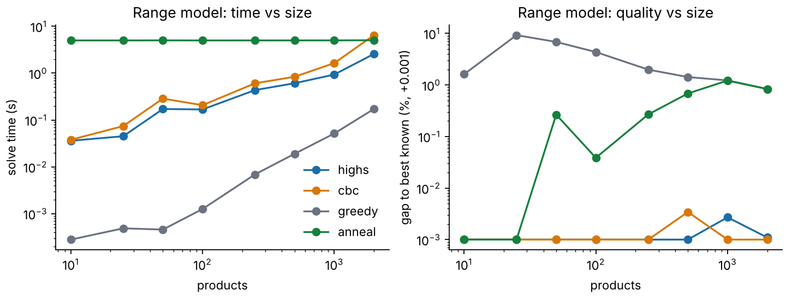

# aisleopt: technical note

Michael Samuel · October 2026 · open-source Python: Pyomo, HiGHS, CBC, SciPy, SimPy · 34 tests

## 1. What it is, and what it is not

Four retail decision models, each solved by an exact method and a heuristic and judged by simulation or by a planted answer. Real data: the cold-cereal category of The Complete Journey (US grocer, 2017, CC0, 565 products appear, 274 sold, 52 weeks). Everything else is simulated or assumed, and labelled. It is not Sainsbury's data and the figures are not UK effects.

## 2. Formulations

**Range.** Binary x_i (ranged), continuous y_ij (delisted item i sends its demand to ranged neighbour j among its five nearest by price in the same sub-category).
max Σ p_i x_i + τ Σ s_ij m_j d_i y_ij; subject to Σ w_i x_i ≤ W; y_ij ≤ x_j; Σ_j y_ij + x_i ≤ 1; each sub-category keeps at least L products; no supplier holds more than 35% of W.
p_i is weekly profit, d_i weekly demand, m_j profit per unit of j, τ the transfer rate (assumed 0.6; 0.3 and 0.9 tested), s_ij a price-distance similarity.

**Promotion.** Binary y_ptk for item p, week t, type k (mailer, display). Gain = base × price × (e^u_k (margin − c) − margin), with u_k the log uplift from the real category model and c the price funding (assumed 18%). Slots per week, display slots, spacing, per-item cap.

**Replenishment.** First stage: order-up-to S_i. Second stage, per demand scenario: sales q_is ≤ min(S_i, D_is), plus carry-over r_is ≤ min(S_i − q_is, D′_is) valued at the unit cost it saves. One shared shelf constraint. LP, 1,000 scenarios. Scored in SimPy: customers arrive through the day, FIFO, shelf life, delivery lead time, common random numbers across plans.

**Markdown.** Choose prices p_t (non-increasing) and sales s_t ≤ a_t (p_t/p_0)^−e, with Σ s_t ≤ stock; leftover earns salvage. SLSQP (five starts), a dynamic programme on a price and stock grid, and a MIP on L price levels.

## 3. Planted answers

Range (τ = 0): the planted set fills the shelf exactly and each planted item earns more profit per unit of width than any other, so it solves the relaxation and is therefore optimal; all four methods reached it on 12 of 12 instances. Replenishment: newsvendor quantile at the critical ratio; the LP is within 0 to 1 units. Markdown: with e > 1 a single price is optimal; SLSQP reaches it to 0.000%. Promotion: regret against the plan built on the true uplifts.

## 4. Results

On the range model the exact solvers dominate this structure: 2,000 products solve to a proven gap under 0.01% in 2.6 s (HiGHS) and 6.5 s (CBC); greedy is 0.8% to 12% short; annealing is 0% to 1.6% short. On the real catalogue the exact answer beats a profit-density fill by 0.15% to 5.9%. The promotion plan adds 4.4% to modelled profit; noisy uplift estimates cost 3% to 29% of the achievable gain in the twin. The stochastic replenishment plan wins only when the shelf is tight (+1.4% at 70% shelf), ties at 90% and loses slightly at 115%. The markdown MIP converges to within 0.1% at 32 price levels.

The full tables are in RESULTS.md, generated from outputs/results.json.

## 5. Limits

Demand transfer is one step and within a sub-category; promotion uplift is one category-wide coefficient; replenishment treats items as independent apart from the shelf; the elasticity is observational; margins and costs are assumed; the replenishment line is treated as short-life although cereal is not; the twin favours the methods in two ways (planted optima are structured, and the noise is Gaussian). No store-level data was available. CI has not run on GitHub. Nothing has been tested with a retailer.

## 6. Hand-off

`aisleopt` command line with validated inputs and bounded run time; seeds and versions in each result; model card; tests; GitHub Actions; four decision memos each ending in the test to run first (A/B or matched-store; code and power tables included).
